<!--
  SHARUU-dev profile README
  -------------------------
  Every visual block is a self-contained SVG in /assets (no external fonts or images).
    - scripts/generate_assets.py  -> hero, sections, stack, projects, services, links, footer
    - scripts/update_stats.py     -> assets/telemetry.svg (real GitHub numbers)
    - .github/workflows/profile.yml -> refreshes telemetry.svg + snake-dark.svg automatically
  Edit copy in the DATA section of generate_assets.py, run it, commit assets/.
  Check everything with: python3 scripts/check_readme.py
-->


<!-- ============================ 01 OVERVIEW =========================== -->



<!-- ============================ 02 STACK ============================== -->



<!-- ============================ 03 PROJECTS =========================== -->


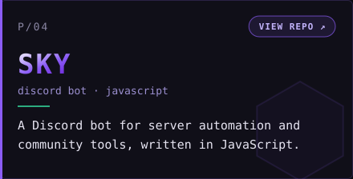

<!-- ============================ 04 TELEMETRY ========================== -->


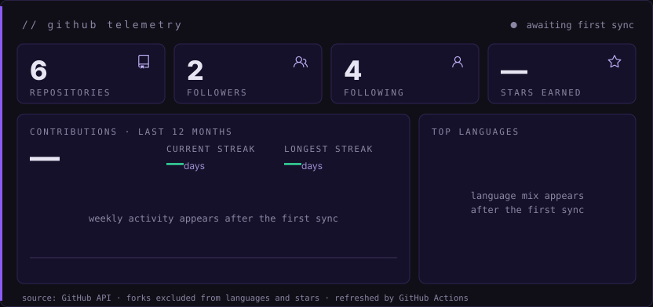


<!-- ============================ 05 WORK WITH ME ======================= -->



Fixed quote before I start · 50% upfront on bigger jobs · setup guide included, help if something breaks. Tell me what you want built. A rough idea is enough.

<a href="https://github.com/SHARUU-dev"></a>
<a href="https://www.youtube.com/@SHARUUX-001"></a>
<a href="https://www.instagram.com/sha.ruux/"></a>


