<!--
  SHARUU-dev profile README
  -------------------------
  Every visual block is a custom SVG in /assets (generated by scripts/generate_assets.py).
  To change text, edit the DATA lists at the top of that script, run it, and commit the new SVGs.
  Only things to edit by hand here: the email address near the bottom.
-->

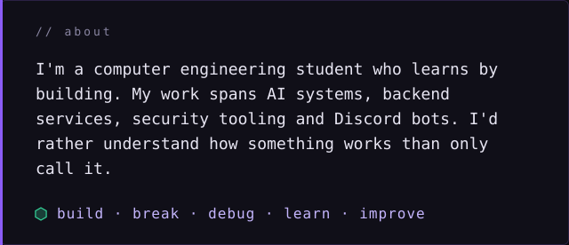

<!-- ============================ 01 MODULES ============================ -->



<!-- ============================ 02 PROJECTS =========================== -->

<!-- ============================ 03 HIRE =============================== -->



<!-- ============================ 04 CONTACT ============================ -->

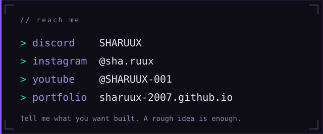

[Instagram](https://www.instagram.com/sha.ruux/) · [YouTube](https://www.youtube.com/@SHARUUX-001) · [Portfolio](https://sharuux-2007.github.io/) · [Email](mailto:your-email@example.com)

